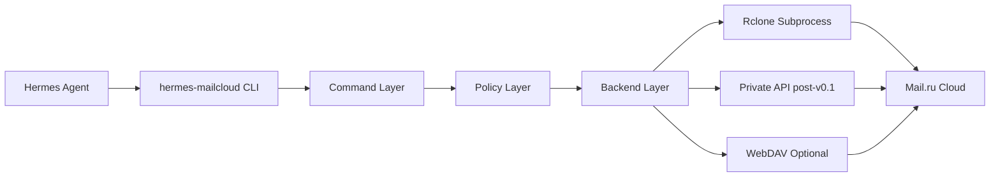

# 01. Architecture — Hermes MailCloud

<!-- hmc-json-example-default: non-contract -->

## Current in-process application interface

Этот раздел описывает поддерживаемый API пакета **0.2.0**, а не прежний
immutable release wheel `v0.1.0`. Версия не заменяет проверку происхождения
установленного артефакта. Канон Python-контракта —
[`application/service.py`](../src/hermes_mailcloud/application/service.py) и
[`application/contracts.py`](../src/hermes_mailcloud/application/contracts.py),
не отдельная HTTP/JSON-схема или реестр команд.

Поддерживаемый вход `hermes_mailcloud.application` предоставляет пятнадцать методов
`MailCloudApplication`: `version`, `setup`, `doctor`, `ls`, `stat`, `mkdir`, `upload`,
`download`, `mv`, `cp`, `rm`, `publish`, `link`, `batch`, `batch_file`. Это синхронные
вызовы в процессе потребителя; HTTP-сервера, GUI/MCP, общей живой сессии или фоновых
jobs нет. Все shipped CLI handlers переводят аргументы, вызывают API, выводят
существующий envelope и применяют exit:

```text
Python consumer ───┐
CLI handlers ──────┴→ MailCloudApplication → config/composition
                       → commands / batch / doctor / installer + existing infrastructure
                       → safe ResultEnvelope → consumer/output adapter
```

Стрелки обозначают вызов и передачу результата, не линейную цепочку imports.
CLI `batch <file>` вызывает `batch_file(Path)`; Python consumer может передать уже
декодированный документ в `batch(document)`. Внутренние services не являются
вторым публичным SDK. Legacy execution helpers и двойной CLI injection отсутствуют;
конфигурация/defaults/admission и исполнение не дублируются в адаптере.
[Исходный план](plans/command-first-refactor.md) — проектное обоснование, не
текущий reference API.

Пример для Python-окружения с пакетом 0.2.0 и выбранным подключением:

```python
from hermes_mailcloud.application import CallOptions, MailCloudApplication

application = MailCloudApplication()
response = application.ls(
    "/Hermes", options=CallOptions(timeout_seconds=30, retries=0)
)
payload = response.to_payload()
exit_code = response.exit_code
planned = application.mkdir(
    "/TEST/example-plan", options=CallOptions(dry_run=True)
)
```

File/public методы вызывают существующих owners, а не воспроизводят их алгоритмы:

| Методы | Сценарий и сохранённая граница |
|---|---|
| `mkdir` | Нормализованный remote path, один write либо meaningful dry-run plan |
| `upload`, `download` | Local/remote paths и `overwrite`; upload не создаёт ссылку, download использует sibling temp и существующий commit/no-clobber owner |
| `mv`, `cp` | Два разных нормализованных remote paths и прежняя overwrite policy |
| `rm` | Genuine boolean `recursive`, обязательный `yes` для реального удаления и неизменённые protected roots |
| `publish`, `link` | Фиксированный public root/deny patterns, native private-journal preflight перед cloud, запись после link, наружу только fingerprint |

Standalone `link` не требует `yes`; реальный `publish` требует. Подтверждение в
`CallOptions` выражает намерение текущего процесса, не аутентифицирует внешний
запрос. Dry-run всех восьми file/public writes даёт план без backend invocation,
download temp и journal prepare/record; policy, overwrite и реальный local source
всё равно валидируются. `never` сохраняет существующий/конкурентный download target;
`if-newer` использует наблюдаемые timestamps. Ни batch transaction, ни rollback после
timeout не обещаны. Ошибка записи journal после link может следовать уже состоявшемуся
cloud-эффекту: нет retry, unlink или автоматического rollback. Подробности —
[модель безопасности](05-safety-model.md) и
[ошибка после public operation](08-configuration-and-secrets.md#failure-after-a-public-operation).

### Setup, doctor и два batch-входа

- `setup(*, archive=None, options=None)` принимает `Path` для заданного архива и
  вызывает настоящий pinned installer с environment snapshot экземпляра. File backend
  и configured cloud remote не нужны. Config разрешается обычным resolver-ом;
  никакой другой метод не вызывает setup скрыто. Dry-run не скачивает/не исполняет
  rclone и не создаёт managed files. Параметр retries не добавляет повтор установки.
- `doctor(*, live=False, options=None)` принимает genuine boolean. Live без yes —
  confirmation_required/9; затем live+yes+dry-run — invalid_arguments/2. Оба отказа
  предшествуют config/backend, в том числе при неверном env profile. Read-only doctor
  с dry-run продолжает чтения; успешный report с отрицательными checks не означает
  readiness. Live использует существующие probes/HTTP/cleanup и warnings; публичного
  trusted invocation или custom test-root параметра нет.
- `batch(document)` и `batch_file(path: Path)` сначала используют настоящий JSON-shaped/
  UTF-8 parser, затем одну composition на весь пакет. Caller-supplied `BatchPlan`
  не является разрешённым обходом parsing. Исполнение координирует `BatchCommands`,
  а не рекурсивные вызовы façade с новым config на item. Оба входа возвращают
  `operation="batch"`. Плохой input не скрывается ошибкой profile metadata; admitted
  input всё равно получает ошибку настоящего resolver-а при неверном профиле.

Batch сохраняет defaults плана (omitted overwrite — `never`, не profile default),
outer yes для любого write, read retry budget и полный preflight до backend. All-item
dry-run, включая reads, выдаёт планы без backend/temp/journal mutations. Реальный
public preflight может подготовить private directory/lock до позднего отказа.
Partial batch возвращает `ok=false`, result со `status=partial_failure`, ordered items
и exit 11 **без top-level error**. Total считает выполненные попытки, а не исходную
длину плана после stop. Ordinary unexpected item exception становится fixed safe
unknown item error и сохраняет прежние outcomes/stop-or-continue; `BaseException`
не превращается в обычный исход. Ни транзакции, ни автоматического replay нет.
Parser/schema ограничения описаны в [контракте batch](02-command-contract.md#20-команда-batch-).

API сам ничего не печатает и не требует Typer/Click/Rich. Он возвращает существующий
`ResultEnvelope`: `operation`, result либо typed error, прежний exit code и
санитизированные прямые данные, а не только безопасный `to_json()`. Ожидаемые ошибки
сохраняют `ErrorKind`; неожиданное `Exception` даёт безопасный `unknown_error`/1 без
exception content и обещания отсутствия эффекта. Ошибка Python-арности/неизвестного
keyword остаётся `TypeError`; `BaseException` не превращается в успех.

Конструктор только копирует environment и сохраняет доверенные зависимости.
`version` не читает config и не создаёт backend. Config и нужный runner собираются
заново на вызов; batch использует их один раз на пакет, setup не создаёт file runner.
Изменения файла настроек видны следующему вызову, изменения environment — новому
экземпляру. Последний результат/runner не кешируются.
DI — seam доверенного хоста, не sandbox; `Path.home()`/`expanduser()` могут учитывать
process home, поэтому передача environment не заменяет раннюю изоляцию теста.

`CallOptions` содержит `config=ConfigOverrides()`, `trace_id`, `dry_run=False`,
`yes=False`, `timeout_seconds=None` и `retries=None`. `None` означает отсутствие
runtime override, а `retries=0` — явный нулевой бюджет. Нужны настоящие boolean и
целые timeout/retries без bool/float/строк; неверные типы отклоняются до config.
Remote/local file-operation paths — строки; `archive` и `batch_file.path` — `Path`.
`overwrite` — `None`, `never`, `always` или `if-newer`,
без неявного coercion. Нормализация, policy, parser и безопасные read retries
остаются у существующих owners. `ls` принимает `recursive`, `files_only`,
`dirs_only`; file/directory `stat` сохраняет доступные metadata/hashes.
`dry_run=True` не отменяет standalone read-вызов backend. Для восьми standalone
file/public writes profile read retries не наследуются: default равен нулю; explicit
positive budget отклоняется даже для dry-run. В write-batch он тоже запрещён;
read-only batch и safe doctor reads/readbacks используют read budget. Timeout
относится к одному backend invocation, не ко всему publish/batch/doctor; installer
сохраняет собственный общий deadline.

`ConfigOverrides` — нейтральное имя прежних profile/remote/config_path overrides;
`CliConfigOverrides` остаётся совместимым alias. Precedence и отдельный
`RCLONE_CONFIG` описаны в [конфигурации](08-configuration-and-secrets.md#5-приоритет-настроек-).
Повторная безопасная проекция идемпотентна; маркер redaction не даёт права пропустить
секрет рядом с ним. Schemas, publication/confirmation/journal и write-once правила
не расширены новой application-границей.

## Historical architecture proposals

> [!important]
> **Contract freeze (2026-07-24):** the v0.1 public command set is `doctor`,
> `ls`, `stat`, `mkdir`, `upload`, `download`, `mv`, `cp`, `rm`, `publish`,
> `link`, and `batch`. `unlink` needs a bounded live invalidation proof;
> `sync`, `resolve`, private API, expire/password links and full link audit are
> post-v0.1. `auth` remains configuration readiness, not a command. Older
> architecture options below are proposals, not current CLI behavior.

> Статус: draft  
> Дата: 2026-07-04  
> Проект: `hermes-mailcloud`  
> Назначение: описать архитектуру агентской CLI-утилиты для Mail.ru Cloud.

---

## 1. Цель архитектуры 🧭

`hermes-mailcloud` — это не “ещё один облачный клиент”. Это агентский CLI-инструмент для Гермеса.

Главная цель:

```text
Дать агенту безопасный, предсказуемый и JSON-совместимый способ работать с Mail.ru Cloud.
```

Утилита должна уметь:

```text
загружать файлы
скачивать файлы
управлять папками
создавать публичные ссылки
возвращать стабильный JSON
защищать пользователя от случайной публикации личных данных
```

---

## 2. Архитектурный принцип 🧱

Проект строится слоями:



Главное правило:

```text
v0.1 не реализует собственный Mail.ru Cloud API-клиент.
v0.1 управляет rclone как внешним backend-ом.
```

---

## 3. Почему rclone subprocess first 🛠️

### Причины

| Причина | Объяснение |
|---|---|
| Mail.ru backend уже существует | не надо писать файловый backend с нуля |
| Public links уже поддержаны | `rclone link` закрывает MVP |
| rclone живой проект | меньше риска, чем у старых reverse-engineered клиентов |
| subprocess проще RC-сервера | меньше surface area и проблем безопасности |
| проще тестировать fake-first | можно мокать команды и stdout |
| меньше лицензионных рисков | rclone вызывается как внешний бинарник |

### Не используем в v0.1

```text
rclone RC server
vendored rclone binary
fork rclone
native Go plugin
полный private API client
```

Rclone RC можно добавить позже, если понадобится высокая производительность при большом количестве операций.

---

## 4. Слои системы 🧩

### 4.1 CLI Layer

Отвечает за:

```text
парсинг аргументов
глобальные флаги
команды
help
exit codes
выбор JSON/human output
```

Рекомендуемый стек:

```text
Python 3.12+
Typer
Rich только для human-output, не для JSON
```

### 4.2 Command Layer

Команды проекта:

```text
doctor
ls
stat
mkdir
upload
download
mv
cp
rm
publish
link
batch
```

`auth` is configuration readiness handled by `doctor`, not a command. `unlink`
is conditional on live unlink-plus-invalidation evidence. `sync` and `resolve`
are post-v0.1 proposals, not command-layer members for this release.

Command Layer не должен знать детали rclone. Он должен вызывать абстрактный backend.

---

### 4.3 Policy Layer

Отвечает за безопасность.

Правила:

```text
publish только внутри /Hermes/public
rm требует --yes
publish и batch write operations требуют --yes
опасные файлы нельзя публиковать
секреты не попадают в stdout/stderr/logs
```

Policy Layer должен работать до backend-операций.

Пример:

```text
publish ./secret.env /Hermes/public/secret.env
→ error: dangerous_file_pattern
```

---

### 4.4 Backend Layer

Backend Layer скрывает способ выполнения операций.

В v0.1 основной backend:

```text
RcloneBackend
```

Плановые backend-и:

```text
RcloneBackend      v0.1
PrivateApiBackend  v0.2+
WebDavBackend      v0.3+
```

---

### 4.5 Rclone Runner

Минимальный интерфейс:

```python
class RcloneRunner:
    def run(self, args: list[str], timeout: int | None = None) -> RcloneResult:
        ...
```

`RcloneResult`:

```json
{
  "returncode": 0,
  "stdout": "...",
  "stderr": "...",
  "duration_ms": 1200
}
```

Runner не должен напрямую печатать в консоль.

---

### 4.6 Output Layer

Все команды должны возвращать единый envelope.

Успех:

```json
{
  "ok": true,
  "operation": "publish",
  "result": {
    "remote_path": "/Hermes/public/report.pdf",
    "public_url_fingerprint": "sha256:example-public-link"
  },
  "warnings": []
}
```

Ошибка:

```json
{
  "ok": false,
  "operation": "publish",
  "error": {
    "kind": "unsafe_public_path",
    "message": "Publishing is allowed only inside /Hermes/public.",
    "details": {
      "remote_path": "/Personal/report.pdf",
      "public_root": "/Hermes/public"
    },
    "exit_code": 9
  }
}
```

---

## 5. Предлагаемая структура проекта 📁

```text
hermes-mailcloud/
├── README.md
├── LICENSE
├── THIRD_PARTY_NOTICES.md
├── pyproject.toml
├── docs/
│   ├── 00-research-summary.md
│   ├── 01-architecture.md
│   ├── 02-command-contract.md
│   ├── 03-development-plan.md
│   ├── 04-probe-plan.md
│   ├── 05-safety-model.md
│   ├── 06-testing-strategy.md
│   ├── 07-agent-integration.md
│   ├── 08-configuration-and-secrets.md
│   ├── 09-known-risks.md
│   └── adr/
├── schemas/
│   ├── result-envelope.schema.json
│   ├── batch-plan.schema.json
│   └── doctor-report.schema.json
├── scripts/
│   └── probes/
│       ├── 00_env_probe.py
│       ├── 01_file_ops_probe.py
│       ├── 02_publish_probe.py
│       └── 03_unlink_probe.py
├── src/
│   └── hermes_mailcloud/
│       ├── __init__.py
│       ├── cli.py
│       ├── config.py
│       ├── core/
│       │   ├── errors.py
│       │   ├── result.py
│       │   ├── paths.py
│       │   └── policy.py
│       ├── rclone/
│       │   ├── runner.py
│       │   ├── parser.py
│       │   └── backend.py
│       ├── commands/
│       │   ├── doctor.py
│       │   ├── files.py
│       │   ├── publish.py
│       │   └── batch.py
│       └── output.py
└── tests/
    ├── unit/
    ├── integration/
    ├── golden/
    └── live/
```

---

## 6. Runtime dependencies ⚙️

### Required

```text
Python 3.12+
rclone
Mail.ru account
Mail.ru app password
configured rclone remote
```

### Python dependencies

```text
typer
pydantic
pydantic-settings optional
rich optional
pytest
```

### Optional later

```text
httpx
tenacity
jsonschema
keyring
```

---

## 7. Конфигурация 🔧

Файл:

```text
~/.config/hermes-mailcloud/config.toml
```

Пример:

```toml
[profiles.default]
remote = "mailru:"
rclone_path = "rclone"

private_root = "/Hermes/private"
public_root = "/Hermes/public"
# explicit doctor --live uses a fresh /TEST/<unique-run-id>/ descendant

default_overwrite = "never"
probe_public_url = true
deny_dangerous_publish = true

links_journal = "~/.local/share/hermes-mailcloud/links.jsonl"
```

Пароли не хранятся в конфиге `hermes-mailcloud`.

Credentials остаются в:

```text
rclone config
```

или передаются внешним секретным механизмом окружения.

---

## 8. Backend mapping 🗺️

| Операция | v0.1 backend | Команда rclone |
|---|---|---|
| list | rclone | `rclone lsjson remote:path` |
| stat | rclone | `rclone lsjson remote:path --stat` или parent lookup |
| mkdir | rclone | `rclone mkdir remote:path` |
| upload | rclone | `rclone copyto local remote:path` |
| download | rclone | `rclone copyto remote:path local` |
| mv | rclone | `rclone moveto remote:old remote:new` |
| cp | rclone | `rclone copyto remote:old remote:new` |
| rm file | rclone | `rclone deletefile remote:path` |
| rm dir | rclone | `rclone purge remote:path` with safety gates |
| link | rclone | `rclone link remote:path` |
| publish | rclone | `copyto` + `link` |
| unlink | conditional after live proof | `rclone link --unlink` only; no private API fallback in v0.1 |

---

## 9. Safety gates 🔐

### 9.1 Public root gate

Публикация разрешена только внутри:

```text
/Hermes/public
```

Пример ошибки:

```json
{
  "ok": false,
  "operation": "publish",
  "error": {
    "kind": "unsafe_public_path",
    "message": "Publishing outside /Hermes/public is blocked by policy.",
    "exit_code": 9
  }
}
```

### 9.2 Confirmation gate

Опасные операции требуют `--yes`:

```text
rm
publish
batch write operations
```

### 9.3 Dangerous file gate

Запрещённые имена для публикации:

```text
.env
*.env
*.key
*.pem
*.p12
*.db
cookies*
tokens*
secrets*
id_rsa*
```

---

## 10. Error model 🧯

Базовые `error.kind`:

```text
invalid_arguments
config_error
rclone_not_found
remote_not_configured
access_denied
not_found
conflict
unsafe_public_path
dangerous_file_pattern
confirmation_required
backend_unsupported
network_error
retry_exhausted
timeout
parse_error
unknown_error
```

`partial_failure` is a batch result status with process exit `11`, not an
`error.kind`.

---

## 11. Почему не форк rclone в v0.1 🧠

Форк rclone не нужен на первом этапе, потому что:

```text
rclone уже умеет основной сценарий
subprocess даёт быстрый MVP
форк добавит поддержку upstream, сборки, CI, релизы
нужно сначала доказать операции live-probe-скриптами
```

Форк допустим позже, если:

```text
найден баг в Mail.ru backend
нужна поддержка unlink/expire в backend
нужно изменить public link implementation
изменение стоит upstream PR
```

---

## 12. Архитектурные решения v0.1 ✅

| Решение | Статус |
|---|---|
| Python + Typer | принято |
| rclone subprocess | принято |
| JSON-first | принято |
| publish только через public root | принято |
| private API не в v0.1 core | принято |
| live-probe до private API | принято |
| не копировать GPL-код | принято |
| WebDAV не основной backend v0.1 | принято |

---

## 13. Итог 🏁

Архитектура v0.1 должна быть простой:

```text
CLI → Policy → RcloneRunner → JSON output
```

Всё остальное добавляется только после probe-доказательств.

Главная идея:

```text
Не строить идеальный облачный клиент.
Построить надёжный агентский инструмент.
```
